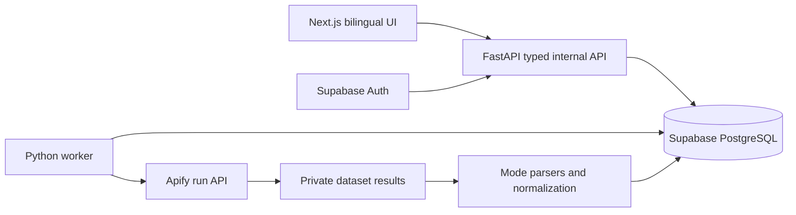

# Flight cheaker — stack fit for the observed Apify format

2026-10-12 Vercel-oriented update: proposed Next.js/TypeScript full-stack alternative is now the prepared goal recommendation; see [vercel-fullstack-option.md](vercel-fullstack-option.md). Earlier Python details below remain an alternative; storage/contracts/acceptance stay applicable. No implementation or final stack acceptance inferred.
2026-10-12. Development recommendation after a bounded real probe, not an implemented application. User selected Apify for a free-first personal tool. The internal contract in data-contract.md is ours; Actor input schema is the publisher's; live fixtures are sampled responses, not an official output JSON Schema.

## Recommended stack

| Layer | Choice | Reason in this project |
|---|---|---|
| Frontend | Next.js App Router + TypeScript + existing CSS tokens/modules | Preserve the responsive aviation canvas, floating panels, 8/4 dashboard and bilingual UX; typed nested leg/segment DTOs. No Streamlit rewrite. |
| Visualization | ECharts, client-side chart components | Separate historical observations from current travel-date prices, explicit gaps and accessible tables. Reuse approved visual theme; do not treat the prototype's vendored version as a production version pin. |
| Server state / language | TanStack Query; semantic zh-Hans/en catalogs, compatible next-intl integration | Job polling, cache freshness and cancellation without paid queries on hover/locale changes. Language-neutral canonical data. |
| API | FastAPI + Pydantic v2 + HTTPX | Validate inputs, type the mode-specific responses, normalize money/time/baggage and call Apify REST with bounded timeouts. |
| Data | Supabase PostgreSQL/Auth; SQLAlchemy + psycopg3 | Relational segment/quote history, owner isolation, durable jobs, atomic budget ledger. Use Supabase CLI for the sole SQL migration history. |
| Jobs | One Python worker + PostgreSQL leases/checkpoints | Apify runs are asynchronous and metered; keep run IDs across restarts and poll existing runs, never launch a duplicate on client timeout. No Redis/Celery required initially. |
| Verification | pytest; Vitest/Testing Library; Playwright | Domain and fixture integration, DB/Auth isolation/recovery, bilingual desktop/mobile flows. Live provider tests remain opt-in and cost-capped. |

Node24 and Python3.12 are candidate baselines; verify current framework/library compatibility in isolated project environments before locking actual versions. No runtime dependencies were installed in this phase.

Pure Next.js/TypeScript remains a reasonable lower-service-count alternative for an HTTP-only connector, but JSON itself does not force any language. The recommendation retains the user's Python preference and already-reviewed architecture. Streamlit can prototype analysis quickly but requires substantial custom work to reproduce the approved motion/layout/split-view experience.

## Adapter boundaries driven by real data

- Map `routes` and `departure_date`/`return_date`, cabin/currency/passengers/bags through an adapter. Internal requested baggage is more expressive than the Actor, so reject unsupported weights/counts rather than silently dropping them.
- `search` / `return` have `itineraries[].legs[].segments[]`; `booking` has top-level `legs` and `booking_options`; `calendar` has `prices`. Model distinct envelopes, not one universal flat list. Platform SUCCEEDED does not certify results: inspect every dataset row for error/empty/schema changes.
- An initial round-trip result contains the outbound leg; return lookup contains the next leg. Persist selected outbound context, combine it with the selected return, and verify booking data before claiming a complete itinerary or final total. Never add two prices unless documented as additive.
- Treat `departure_token`, `booking_token`, `price_token`, booking_request and token-bearing URLs as transient server-only references, not primary keys or public API fields. Apply expiry/redaction rules.
- `departure_time` / `arrival_time` in the sampled data lack offsets. Preserve source strings and establish their semantics against verified airport/provider information before converting with IANA zones. DST ambiguity/nonexistent times need explicit handling. Unknown semantics exclude a result from confirmed rendezvous; attaching UTC blindly is invalid.
- Convert prices to integer minor units with Decimal and currency fraction digits. `display_price` is presentation only; numeric `price` is not necessarily a fully verified baggage-inclusive amount.
- Baggage evidence is weak in this sample: checked counts were null, the one-way booking baggage array was empty, the round-trip array only named one free carry-on, and one carry-on-filtered result reported zero included. Requested counts must not become confirmed included counts. Mark unknown/contradictory evidence explicitly and exclude it from confirmed qualifying rankings.
- `price_insights.price_history` stays route/search reference, not history of a specific fare/flight. Own history starts with verified comparable observations and truthful timestamps; no synthetic backfill.
- The calendar probe returned three departure dates with a fixed return date and coverage2/3. A date window is not proven to yield a Cartesian departure/return matrix. Enumerate return dates or explicit date-pair searches within quota; verify selected cells with complete itinerary/baggage evidence.

Exact observed fields and charges: [live spike report](../connectors/apify-live-spike-2026-10-12.md). The provider is selected for development evaluation, not certified for all four functions.

## Deployment and configuration

Reuse [free-deployment.md](free-deployment.md): Vercel Hobby frontend, Render Free API/co-located supervised worker for a personal demo, Supabase Free database/Auth. Sleep pauses jobs and automatic monitoring remains off. Separate persistent worker is a later availability choice. No deployment is authorized by this design document.

Only the backend needs APIFY_API_TOKEN. Pin tested Actor build0.0.2 initially; verify changes before upgrading. Frontend needs the public Supabase URL/publishable key and API URL; SQL runtime roles and migration connection remain separate. The connected Supabase management channel still lists no visible project, so project selection/configuration is a live integration gate.

Proposed free-first monthly app charge cap USD4, below the advertised USD5 platform allowance, with an initial USD0.10 per-job ceiling. Actual remaining account allowance and other account usage take precedence; no paid overage, auto-upgrade or paid fallback. Platform reads/storage/start charges also count. A monthly request-count cap alone cannot enforce dollars across search/calendar modes. Read and persist platform-reported usage and reservations; reject oversized plans before dispatch.

## Decision and acceptance

Use this stack to implement the approved UI and deterministic domain logic, with Apify behind an adapter. Keep live capabilities explicitly documented/observed/confirmed/unknown. If baggage evidence remains insufficient, ship an honest unknown state and report the unmet original acceptance condition; do not call the full requested tool complete. Another provider requires a separately authorized key/cost decision, never silent fallback.

The prepared [development goal prompt](../development-goal-prompt.md) authorizes implementation only when the user invokes it. This turn prepares it and does not start a development goal.
