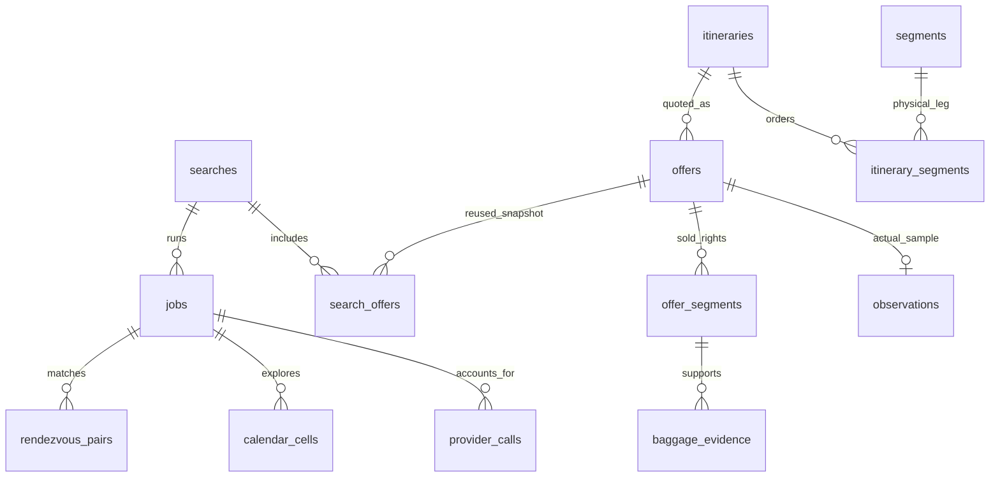

# Flight cheaker data design v0.2

2026-10-12. Reviewable design, not applied SQL or a live schema. Primary recommendation: Supabase managed PostgreSQL and Auth; Next.js frontend; FastAPI plus a separate Python worker. One dedicated development project, never an unrelated existing database. Supabase MCP responded with an empty visible project list today; no project or tables were created or inspected.

## Three distinct data products

| Product | Stored identity | Meaning / cold start |
|---|---|---|
| Current offer | Immutable `offer_id` | Complete one-way/round-trip quote with segment-level rights, expiry and provenance |
| Same-trip history | `owner_id + comparison_key + observed_at` | Actual observations of the exact comparable itinerary/fare context; starts at first real sample |
| Neighboring dates | `owner_id + query_fingerprint + outbound_date + return_date` | Current route candidates for other travel dates; cannot be merged into same-trip history |

Provider price insights remain `scope=route_search` unless documentation and live evidence establish a more specific scope. Supabase stores observations; it does not supply flight prices or historical backfill. A blank history is correct during cold start. Day-to-day price observations for a flight that no longer exists stay associated with the original itinerary; schedule changes create a new physical identity.

## Relational model

All user-owned primary and foreign keys below include `owner_id` (Supabase Auth user UUID). A UUID remains externally addressable, but owner access is checked before returning it. Composite references prevent accidentally connecting one user's job to another user's search. Hashes use versioned canonical JSON, not mutable display names or translated labels.

| Table, schema `flight` | Primary / unique identity | Main contents |
|---|---|---|
| `profiles` | `owner_id` FK `auth.users` | preferred_locale, display_currency, created_at; no ticketing identity data |
| `searches` | PK `(owner_id, search_id)` UUID | immutable submitted criteria JSONB, query_fingerprint, provider, market, provider_language, schema_version, submitted_at |
| `jobs` | PK `(owner_id, job_id)`; scoped FK search | type, phase, status, progress, budget reservation, cancellation, lease_owner/version/expiry, next_attempt_at |
| `itineraries` | PK `(owner_id, itinerary_id)` versioned physical hash | full ordered segment identity; one-way/round-trip structure; no fare-specific cabin/bags |
| `segments` | PK `(owner_id, segment_id)` physical hash | airports, operating/marketing carriers/numbers, UTC scheduled departure/arrival, IANA zones, duration |
| `itinerary_segments` | `(owner_id, itinerary_id, direction, position)` | segment_id FK, ordered leg structure, connection/self-transfer evidence |
| `offers` | PK `(owner_id, offer_id)` UUID; FK itinerary | provider_call_id, fare/rights fingerprint, comparison_key, passengers, currency, base/fee/requested total minor units, price_status, observed_at, fetched_at, expires_at |
| `offer_segments` | `(owner_id, offer_id, direction, position)` | matching itinerary segment_id; sold cabin, fare class if known; does not overwrite physical segment |
| `baggage_evidence` | `(owner_id, evidence_id)`; FK offer segment | item type, included count, weight, fee amount/currency, fee basis/scope, source text and evidence status |
| `search_offers` | `(owner_id, search_id, offer_id)` | acquired/verified state, rank, exclusion reasons; same immutable cached offer can serve a later submitted search |
| `observations` | `(owner_id, observation_id)`; unique scoped offer | comparison_key, actual observation timestamp, price and source provenance; only confirmed complete prices eligible for signal |
| `daily_price_points` | `(owner_id, comparison_key, observation_day)` | count, daily median/mean/min/max, first/last observed_at; derived and rebuildable, not primary evidence |
| `calendar_cells` | `(owner_id, job_id, outbound_date, return_key)` | return_key is explicit single-trip sentinel or return date; coarse price, verification status, verified_offer_id, source timestamp, errors |
| `rendezvous_pairs` | `(owner_id, job_id, pair_id)` | offer_a_id, offer_b_id, UTC arrival gap, combined same-currency total, Pareto label and calculation version |
| `provider_calls` | `(owner_id, call_id)` UUID; unique operation fingerprint per job | method, redacted request hash, reserved units, billable/uncertain units, dispatch time, latency, response status, response digest |
| `budget_accounts` | `(scope, scope_id, period_start, provider)` | account-wide and user limits, reserved/consumed/uncertain units; locked before request reservation |
| `provider_references` | `(owner_id, reference_id)`; FK offer/call | expiring upstream tokens; worker-only grants; never returned to UI or logs |
| `cache_entries` | `(owner_id, query_fingerprint, provider, contract_version)` | results reference, expiry, source freshness; cache hit never changes observed_at |
| `watchlists` | `(owner_id, watch_id)` UUID | future opt-in sampling criteria, cadence, next_run, monthly budget; disabled by default |

`return_key` avoids PostgreSQL NULL-uniqueness surprises. Monetary values use `bigint` minor units, ISO currency and explicit fraction digits. Unknown prices/weights are NULL with reason codes, never zero. Nonnegative amount checks, positive sequence position checks and UTC arrival-after-departure checks are required. Parent uniqueness includes owner so child composite FKs are enforceable. Offer-segment association must reference a real segment position of its parent offer's itinerary; enforce with constrained references/transaction validation and a cross-itinerary rejection test.

## Identities and repeatability

- `search_id`: one submitted request; identical form may have a new search_id but reuse a cache fingerprint. `Idempotency-Key` is scoped to owner and endpoint; different payload with same key returns conflict.
- `itinerary_id`: physical segments only, stable across economy/business and baggage options. Version the hash canonicalization.
- `offer_id`: a new immutable quote snapshot, not a flight number, query ID or booking token. Snapshot insertion is idempotent on `(owner, provider_call_id, provider_result_key)`; no duplicate on worker replay.
- `comparison_key`: itinerary + actual per-segment cabin + passengers + requested baggage + normalized rights/fare identity + provider + currency + market + price completeness. Unknown fare identity means insufficient comparability, not “same fare”.
- UI language is excluded. Upstream market/provider language are fixed connector configuration and included where they can affect returned fares. Changing UI language never triggers a provider request.

## Query and history design

Store source `observed_at` separately from `fetched_at`. If source time is absent, record fetch time with `timestamp_basis=fetch` only when a fresh retrieval is established; an upstream cached or uncertain-age response must be marked and cannot fabricate a fresh observation. Re-reading our cache never creates an observation.

For the detail chart, group valid observations by UTC observation day, use the median of each day's comparable quotes, then calculate the 30-day baseline from daily values so repeated intraday searches do not outweigh other days. Mean remains a separate displayed statistic. Suggested initial signal gate: at least 7 distinct observed days spanning at least 7 days in the last 30 days, last valid quote ≤24h old and current offer not expired. Low ≤−5% versus baseline median; high ≥+5%; otherwise typical. These are product heuristics, not predictive guarantees, and must be versioned/tested. Missing days are gaps; no interpolation or synthetic backfill. A 7-day zoom does not silently change the 30-day signal baseline.

Date prices use ±30 departure days and an explicit stay length. Flexible windows enumerate the departure × return Cartesian product before UTC ordering and destination-night validation; crossing the date line is not rejected solely by local-date comparison. Calendar batches must honor provider limits, then selected cells require full itinerary/baggage verification. Only verified cells compete for the displayed minimum. Keep searched/verified/failed/unknown counts visible.

Rendezvous uses the destination local calendar date plus arrival timestamps in UTC. First filter valid offers for each traveler, then produce nondominated combinations over combined price, arrival gap and duration. Explicitly retain the lowest combined fare and smallest gap alternatives. Labels always state candidate scope, not global market optimality.

## Index plan and query limits

Start with B-tree indexes aligned to real access patterns, including FK columns:

- searches `(owner_id, submitted_at desc, search_id)` for keyset history pagination.
- jobs `(owner_id, job_id)` plus partial worker index `(next_attempt_at, created_at)` where queued/retryable; expired lease index for recovery.
- offers `(owner_id, itinerary_id, observed_at desc)` and `(owner_id, comparison_key, observed_at desc)`.
- observations `(owner_id, comparison_key, observed_at)`; daily points PK already serves chart lookup.
- search_offers `(owner_id, search_id, rank)`; calendar PK for matrix; provider_calls `(owner_id, job_id, dispatched_at)` and billing-period index.

Do not create broad JSONB GIN indexes or partitions without query evidence. Use typed columns for filter/join paths; JSONB for submitted input and limited evidence. Bound result pagination and chart lookback; never load all users' history to filter in Python. Future integration checks use representative seeded data and EXPLAIN; no performance result is claimed today.

## Ownership and Supabase access

Use a private `flight` schema not exposed in the Data API. Browser uses Supabase Auth with a publishable key; all flight data passes through FastAPI. No direct browser writes to jobs, quotas, offers or provider references.

FastAPI validates Supabase access tokens, then opens a DB transaction as restricted `fc_api` (not owner, not BYPASSRLS). Set transaction-local `app.user_id` from the verified subject using a bound SQL parameter. RLS policies compare owner_id to that context, fail closed on missing/invalid context, and use both USING and WITH CHECK for mutations. Database roles are backend-only credentials; the user cannot set this trusted context directly. Tests must prove context does not leak across pooled requests. Authorization never trusts editable user_metadata or client-supplied owner_id.

`fc_worker` has only explicit worker-table grants and matching worker policies for cross-user job processing, no auth-user administration or DDL. Migration credentials are separate and never loaded into web/API runtime. Enable/force RLS on owned tables; keep provider references inaccessible to fc_api. Exposed schemas, if added later, require explicit grants plus RLS. Read views use security-invoker semantics or remain private. No public SECURITY DEFINER shortcut.

Use Supabase asymmetric signing keys/JWKS with verified issuer, allowed algorithms, audience, expiry and subject; bounded cached JWKS refresh supports rotation. Legacy HS256 projects require verified Auth-server lookup rather than merely decoding tokens. Public keys are not secrets. No service_role/secret API key is required for the recommended direct-Postgres runtime.

## Worker, budget and failure semantics

One Python worker initially. Atomically claim queued jobs with `FOR UPDATE SKIP LOCKED`; increment a fencing/lease version. Network requests occur outside DB transactions. Heartbeats and a lease longer than the request timeout prevent ordinary duplicate claims. Completion updates must match the current lease version; stale workers cannot overwrite a recovered job.

Before dispatch, atomically reserve both global provider-account and owner quotas, store the operation ledger and commit. Before network I/O, commit a durable `dispatching` transition conditioned on the current lease version, uncancelled job and reservation ownership. Recovery treats `dispatching` as uncertain even if no response or dispatched timestamp exists; it never automatically resends it, including when a stale original worker might resume. A request dispatched before a crash/timeout becomes `uncertain` if billing cannot be established. Do not blindly resend it; exact-once upstream execution cannot be guaranteed. Recovery reuses stored successful checkpoints; retries require remaining quota and documented billing semantics. Cancel prevents future dispatch but cannot refund an already sent request. Keep immutable quotes in the same completion transaction as the successful checkpoint.

Initial global concurrency2, 40-call spike cap, 1,000 calls/month app cap. Source hourly/account limits additionally apply; the app cap is not the supplier subscription. New histories are collected during user searches; autonomous monitoring remains off until explicitly enabled with a displayed monthly estimate.

## Retention and capacity assumptions

Subject to supplier retention/display terms: short-lived tokens until expiry; redacted raw diagnostic payloads default off, opt-in TTL7 days in a private bucket only if needed; jobs/calls and complete offers90 days; compact observations180 days; daily summaries365 days. Preserve lightweight immutable offer headers, their referenced call/job headers, and itinerary/comparison dimensions while retained observations or summaries depend on them. The 90-day purge removes eligible bulky child evidence and detail payloads, not FK-referenced headers; no cascade may delete longer-lived history. Daily summaries retain their own provenance/counts and comparison dimensions after raw observation expiry. Purge old detail/rights payloads without cascading away retained history; deletion of an account removes all owner data. Raw evidence is never committed to Git.

Capacity illustration, not measurement: 3,000 offers/month ×6KB for normalized offers/children ≈18MB/month before indexes;90 days≈54MB. Indexes, jobs, history, Auth and overhead also consume quota. Measure pg_total_relation_size after a bounded spike, alarm at70% of the selected plan quota and prune eligible data; do not auto-upgrade a paid plan. Supabase Free's500MB ceiling is an initial experiment allowance, not a storage guarantee. Keep export/restore procedures because Free does not include automatic backups.

## Acceptance before live release

Two-user isolation and direct Data API denial; worker lease fencing and crashes immediately before/after durable dispatching and network send; cancellation and uncertain billing; idempotent replay; segment-level baggage/cabin and monetary fee scope; UTC date-line cases; cache freshness and separate chart scopes; exact history gating; bilingual stable error codes; migration from empty Postgres; purge without broken retained history; restore rehearsal. These are future application tests, not covered by the75 prototype browser checks.

## Sources reviewed

- [Supabase API keys](https://supabase.com/docs/guides/getting-started/api-keys)
- [Postgres connections](https://supabase.com/docs/guides/database/connecting-to-postgres)
- [JWT verification](https://supabase.com/docs/guides/auth/jwts)
- [RLS](https://supabase.com/docs/guides/database/postgres/row-level-security)
- [Supabase pricing](https://supabase.com/pricing)
- [SearchApi flights](https://www.searchapi.io/docs/google-flights-api) and [calendar](https://www.searchapi.io/docs/google-flights-calendar-api)

Schema, thresholds, retention and worker choices above are project design judgments. Provider availability, baggage accuracy, fees and legal retention rights remain pending live/account validation.
