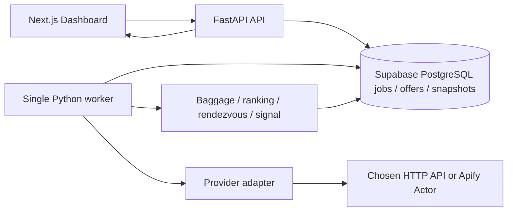

# System design v0.2

Current implementation supersedes the historical proposal below: Next.js/TypeScript Node Route Handlers + Workflow, Supabase restricted PostgreSQL/Auth, Apify search→return only. No production booking enrichment or Python API/worker. See application-status.md and vercel-fullstack-option.md. Full acceptance remains incomplete; cycle03 stopped5/5. Historical diagrams are alternatives, not current runtime.

2026-10-12 Vercel-oriented update: proposed Next.js/TypeScript full-stack alternative is now the prepared goal recommendation; see [vercel-fullstack-option.md](vercel-fullstack-option.md). Earlier Python details below remain an alternative; storage/contracts/acceptance stay applicable. No implementation or final stack acceptance inferred.
建议架构；应用尚未实现。建议使用 Supabase PostgreSQL/Auth；支持本地与免费演示部署，应用尚未实现。详细模型见 [data-design.md](data-design.md)，免费托管边界见 [free-deployment.md](free-deployment.md)。



## Responsibility
- Frontend：输入与可访问状态、列表、详情、历史图、split view、flex grid；不持有外部 provider Key。
- API：输入校验、任务幂等、预算预留、查询/取消、读取标准化结果。
- Worker：从持久 jobs 表领取任务、限流调 provider、标准化、逐段判定、写快照、聚合结果。
- Adapter：能力表、search/calendar/resolve-return/booking/insights；不负责产品排序。
- Rules：纯业务逻辑、money/时区/费用范围处理、comparable key、确定性推荐。

不建议用 FastAPI in-process BackgroundTasks 作为唯一可靠长任务队列。初期 single worker + DB leases：每次 claim 原子事务；lease_expiry 后可重领；阶段结果落盘；取消在下次子请求前检查。重启复用成功 checkpoint；上游 exactly-once 不可保证。发送前持久化 dispatching 状态并核对 lease/取消/预算；崩溃窗口中的不确定请求不自动重发。任务表记录已 dispatched 的 request ledger，无法判断是否计费的超时记 uncertain，不盲目重发。

## Persistence
- searches：输入 JSON、fingerprint、provider、created_at、scope。
- jobs：status、phase、progress、budget、lease、cancel_requested、error_code。
- itineraries / segments：完整物理行程稳定标识、UTC/当地时区、operating/marketing carriers；不存报价专属舱位或行李。
- offers / offer_segments：snapshot ID、itinerary、provider/fare、旅客、逐段舱位及行李证据、minor-unit money、confidence、observed_at。不同报价不能覆盖同一物理航段的属性。
- observations：comparable key、day sample、费用完整性；历史查询不依赖临时 token。
- calendar_cells：date pair、coarse amount、verified offer、pending/failed/unsupported。
- provider_calls：redacted request fingerprint、cost units、status、attempt、checkpoint；不存秘密。
- provider_references：短期 token，服务端限制访问，日志隐藏；原始响应先脱敏再保存。

初期 cache 用 DB expiry 与 fingerprint，无 Redis。缓存 key 含完整输入、provider、schema_version、provider market/language、币种、旅客和行李，避免跨条件串结果。UI locale 不进入 canonical fare cache，切换语言不触发付费请求。历史快照记录真实 observed_at，缓存重复读取不创建伪新增观测。

## Execution flows
固定：validate → reserve quota → search candidates → complete roundtrip → baggage/booking enrichment → confirmed ranking → result. 只核验 10 个候选时结果声明核验范围，不能省略未知低价候选却称绝对 top ten。

会合：分别获取目标到达日可能的出发日候选 → filter local-arrival-day → complete offers → UTC gap constraints → pair recommendations。并发上限建议 provider=2，整个系统 shared budget；不要每个浏览器会话各自突破限流。

灵活：枚举两个区间 date-pair 笛卡尔积（不按跨时区本地日期直接比较）→ calendar batches ≤ provider cap → prioritize → detailed verify UTC顺序/目的地nights → partial results/coverage。provider若本身不支持跨日期变更线组合，标unsupported，不静默排除。取消已发出请求可能仍计费，UI 说明。

历史：detail 使用自己的 comparable snapshots；provider insight 独立 scope；calendar 是当前日期面，不将不同 scope 合并求均值。自动采样需要后续明确启用的监控任务，并先显示预估月查询量。

## Reliability and boundaries
Timeout 30 秒初始建议，job 180 秒可调整。HTTP 429 尊重 Retry-After；transient 5xx 最多 2 次受预算限制重试；401/403、参数错、schema 错不盲重试。未知收费结果不自动重试。日志 trace_id 不含 token/旅客姓名；本工具不收集购票身份资料。

本地 bind 127.0.0.1，单 origin。应用从首版接入 Supabase Auth、owner RLS 与服务端配额；部署使用 HTTPS 和受控 CORS。API 以受限 SQL 角色访问私有 schema，不持有 migration admin 凭证。不需要 LLM、支付系统或航空出票 API。

## Structure (future code, not scaffolded)
```text
frontend/src/app/             routes
frontend/src/features/        search / details / rendezvous / flexible
backend/app/api/              transport
backend/app/domain/           money / baggage / ranking / history
backend/app/providers/        adapters
backend/app/jobs/             orchestration / worker
backend/app/storage/          repositories
supabase/migrations/          sole SQL migration history
backend/tests/                unit / integration / provider fixtures
docs/                         design, contracts, ADR, QA
```

Deployment recommendation: Vercel Hobby frontend + Render Free API/co-located supervised worker + Supabase Free for a personal demo. Sleep means no continuous monitoring guarantee. A persistent separate-worker profile remains the later option. See free-deployment.md. Health readiness distinguishes process start from database/provider availability. Secrets/raw responses excluded from Git. Dependency compatibility is verified only during implementation.
